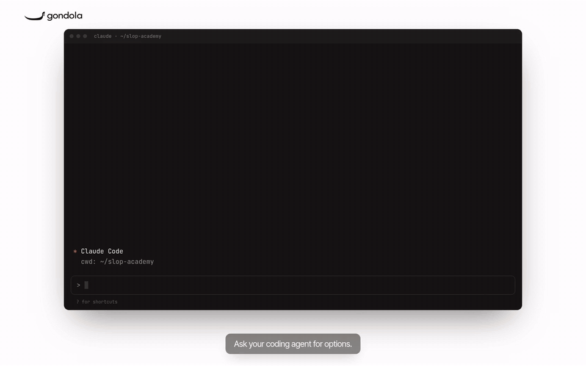

# gondola-cli

**Ask for one change. Get many finished variants of it, built at the same time, each as a patch you can apply.**

<p align="center">
  
</p>

<p align="center">
  <a href="docs/media/promo.mp4">▶ Watch the 50-second film: how Gondola started and how the CLI works</a>
</p>

`gondola explore` copies your repo into a [Boat](https://boat.dev) sandbox, installs it once, forks that sandbox once
per variant, and has a coding agent build each variant against your real dev server. Every variant gets its own
direction: a different composition, and optionally a different angle and voice for the copy. You get a page that
shows them side by side, and one command to take the one you like.

It is the sibling of [Gondola](https://github.com/forever8896/gondola), which redesigns a public homepage 50 ways.
Gondola works from a URL and produces standalone pages. gondola-cli works from your source code and produces diffs.

```sh
gondola explore "Redesign the pricing section so the Team plan is the obvious choice" -n 8 --copy
```

Nothing in your working tree changes until you run `gondola apply <n>`.

## What a run does

1. **Send.** The files git knows about (tracked, plus untracked files that are not ignored) go to one sandbox.
   Ignored files such as `node_modules` and `.env` stay on your machine unless you name them with `--with`.
2. **Install.** Dependencies are installed and the dev server is started once, to check it works and to photograph
   the page as it is now.
3. **Fork.** Boat forks that sandbox once per variant, so no variant installs anything again.
4. **Build.** One agent per fork edits your real components, looks at its own screenshots at 1440px and 390px, and
   fixes what a browser check finds (overflow, overlap, low contrast, script errors).
5. **Collect.** Each variant comes back as `patch.diff`, desktop, phone and full-page screenshots, and a short
   description. The sandboxes are deleted.

Results are in `.gondola/<run>/` in your repo (kept out of git through `.git/info/exclude`). `gondola open` shows
them side by side: every page scrolling in its frame, a detail view with desktop and phone shots, and an Apply button
that copies the command for the variant you want.

## Directions

| Option | What varies |
|---|---|
| default (`--style keep`) | Composition only. Each variant stays in your design system (colours, fonts, components) and gets one of 18 layout ideas: bento grid, comparison table, numbered steps, proof first, and so on. |
| `--style wild` | A restyle. Each variant gets an art direction, palette and font pairing from Gondola's library. |
| `--copy` | The wording too. Each variant gets an angle (outcome led, proof led, contrarian…) and a voice (dry, warm, technical…). Facts are fixed: agents may not invent or change numbers, prices, features, customers or quotes. |

Without `--copy`, text stays exactly as it is.

## Install

You need [Bun](https://bun.sh) 1.3 or newer, git, and the [Boat CLI](https://boat.dev) signed in (`boat login`).

```sh
git clone https://github.com/forever8896/gondola-cli && cd gondola-cli
bun install && bun link        # puts `gondola` on your PATH
```

Agents run as Claude Code on the Claude sign-in you connected in Boat (the default model is `claude-sonnet-5-5`), so
a run costs no extra tokens beyond your Claude plan, plus a few cents of Boat compute. Pass
`--model openrouter:<model>` to pay per token through an OpenRouter key stored in Boat.

## Commands

```
gondola explore "<task>" [options]   Build N variants. Nothing in your repo is modified.
gondola open [--run <id>]            Open the page that compares a run's variants.
gondola show [--run <id>]            The same list as text (--json for an agent).
gondola apply <n> [--run <id>] [-b]  Apply variant n to the working tree (-b: on a new branch). Nothing is committed.
gondola list                         Runs in this repo.
gondola clean                        Delete sandboxes that an interrupted run left behind.
```

Useful options for `explore` (all of them: `gondola --help`):

- `-n 8` number of variants (default 6, at most 50)
- `--path /pricing` the page the change is on
- `--dir apps/web` the app folder in a monorepo
- `--dev "pnpm dev"`, `--install "pnpm install"`, `--port 3000` when detection picks wrong
- `--with .env.local` send an ignored file the app needs to start
- `--polish` add an art-director pass (slower, better)
- `--keep` leave finished sandboxes up for an hour so their live preview links work
- `--json` print the result as JSON for a calling agent

## Use it from a coding agent

`skill/SKILL.md` is a Claude Code skill. Copy the `skill` folder to `~/.claude/skills/gondola` and your agent can
start a run when you ask for options, read the JSON result, show you the wall, and apply the variant you pick.

## Limits

- Web projects with a dev server. The run needs the page to render in a sandbox, so apps that cannot start without
  private services or secrets need those passed in (`--with`) or mocked.
- Agents may not add dependencies or touch config and lockfiles, so a variant is always a source-only patch.
- A patch applies to the files as they were when the run started. If you edit the same files in the meantime,
  `gondola apply` tells you instead of guessing.
- Live preview links (`--keep`) depend on the dev server accepting the sandbox's hostname. Vite is handled; with
  other servers the screenshots are the reliable view.
- Boat's start limits apply: on the $20 plan, 12 sandbox starts a minute and 60 an hour, so a 50-variant run paces
  its forks over a few minutes.

## License

[MIT](LICENSE). The style library and the browser checks come from [Gondola](https://github.com/forever8896/gondola).
